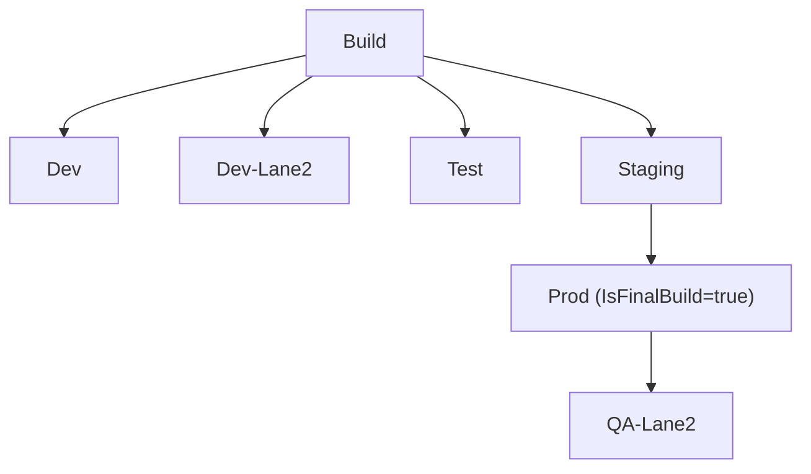

# Stage Design

Covers the standard stage dependency graph, trigger configuration, and conditions for `.NET` app pipelines. Two pipeline files work together: `azure-pipeline.yml` (main CI/CD) and `azure-pipeline-hotfix.yml` (hotfix path).

---

## Contents

- [Stage Design](#stage-design)
  - [Contents](#contents)
  - [Stage Dependency Graph](#stage-dependency-graph)
  - [Triggers](#triggers)
  - [Stage Conditions](#stage-conditions)
    - [azure-pipeline.yml](#azure-pipelineyml)
    - [azure-pipeline-hotfix.yml](#azure-pipeline-hotfixyml)

---

## Stage Dependency Graph



`Dev`, `DevLane2`, `Test`, and `Staging` all depend directly on `Build`. `Prod` depends on `Staging`. `QA-Lane2` depends on `Prod` (main pipeline) or `Build` (hotfix pipeline).

---

## Triggers

The trigger `paths.exclude` on each pipeline file prevents a wasted CI run when only the pipeline YAML itself is updated. The intent is: don't rebuild the app just because someone fixed a pipeline comment.

```yaml
# azure-pipeline.yml
trigger:
  branches:
    include:
      - main
      - dev-lane2
  paths:
    exclude:
      - azure-pipeline.yml

# azure-pipeline-hotfix.yml
trigger:
  branches:
    include:
      - qa-lane2
  paths:
    exclude:
      - azure-pipeline-hotfix.yml
```

---

## Stage Conditions

> All projects follow the **Standard** conditions below. The **MPS/Center Management** block documents approved exceptions for that project only.

Use multi-line for and() conditions for improved clarity.

### azure-pipeline.yml

**Standard**

```yaml
# Dev-Lane2 — only runs on the dev-lane2 branch
condition: |
  and(
    succeeded('Build'),
    eq(variables['Build.SourceBranch'], 'refs/heads/dev-lane2')
  )

# Dev, Test — skip pull requests
condition: |
  and(
    succeeded('Build'),
    ne(variables['Build.Reason'], 'PullRequest')
  )

# Staging — main branch only
condition: |
  and(
    succeeded('Build'),
    eq(variables['Build.SourceBranch'], 'refs/heads/main')
  )

# Prod — main branch, after Staging succeeds
condition: |
  and(
    succeeded('Staging'),
    eq(variables['Build.SourceBranch'], 'refs/heads/main')
  )

# QA-Lane2 — after the final prod server stage succeeds
condition: |
  and(
    succeeded('<NAME_OF_FINAL_PROD_SERVER>'),
    eq(variables['Build.SourceBranch'], 'refs/heads/main')
  )
```

**MPS/Center Management exceptions** — explicitly requested; do not apply to other projects

```yaml
# Dev-Lane2 — routes by branch name contains rather than exact match
# DevLane2 is implicitly PR-safe (PR refs never contain 'lane2')
condition: |
  and(
    succeeded('Build'),
    contains(variables['Build.SourceBranch'], 'lane2')
  )

# Dev_MPS — inverse of above; explicit PR guard covers this side of the split
condition: |
  and(
    succeeded('Build'),
    not(contains(variables['Build.SourceBranch'], 'lane2')),
    ne(variables['Build.Reason'], 'PullRequest')
  )

# Staging — skip PR runs only; allows staging deploys from any branch (not locked to main)
condition: |
  and(
    succeeded('Build'),
    ne(variables['Build.Reason'], 'PullRequest')
  )
```

### azure-pipeline-hotfix.yml

```yaml
# QA-Lane2 — hotfix entry point
condition: |
  and(
    succeeded('Build'),
    eq(variables['Build.SourceBranch'], 'refs/heads/qa-lane2')
  )

# Prod — after QA-Lane2 succeeds
condition: succeeded('QALane2')
```
